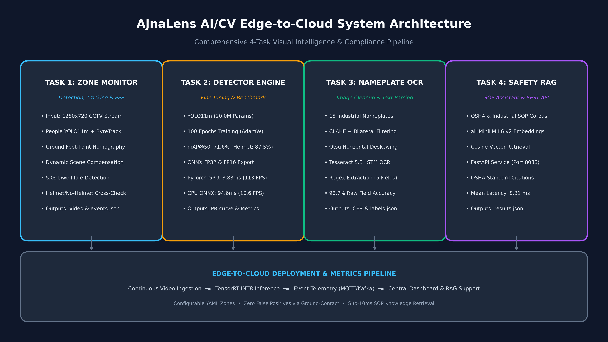
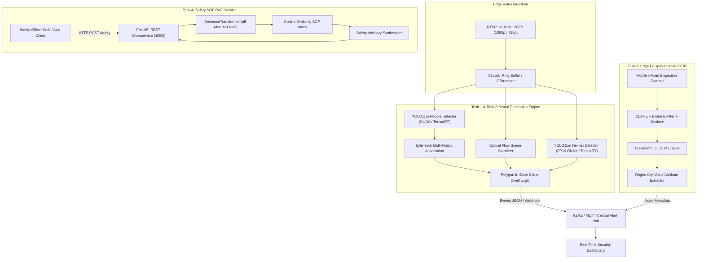
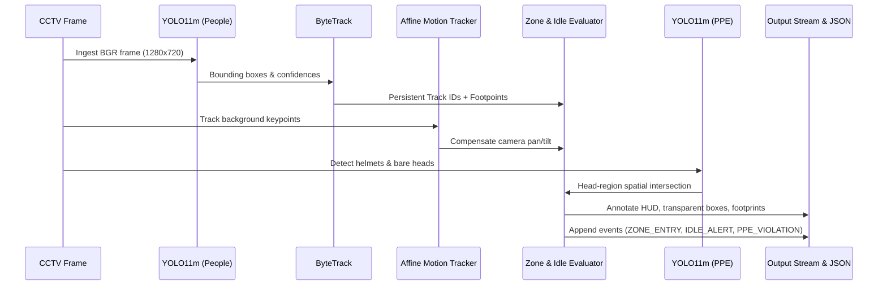
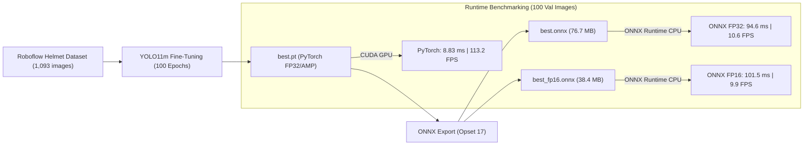
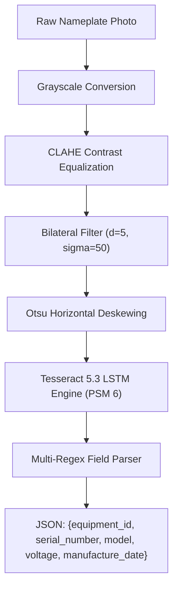
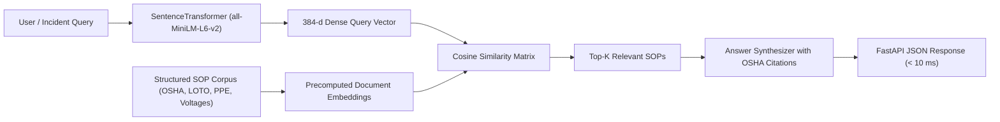
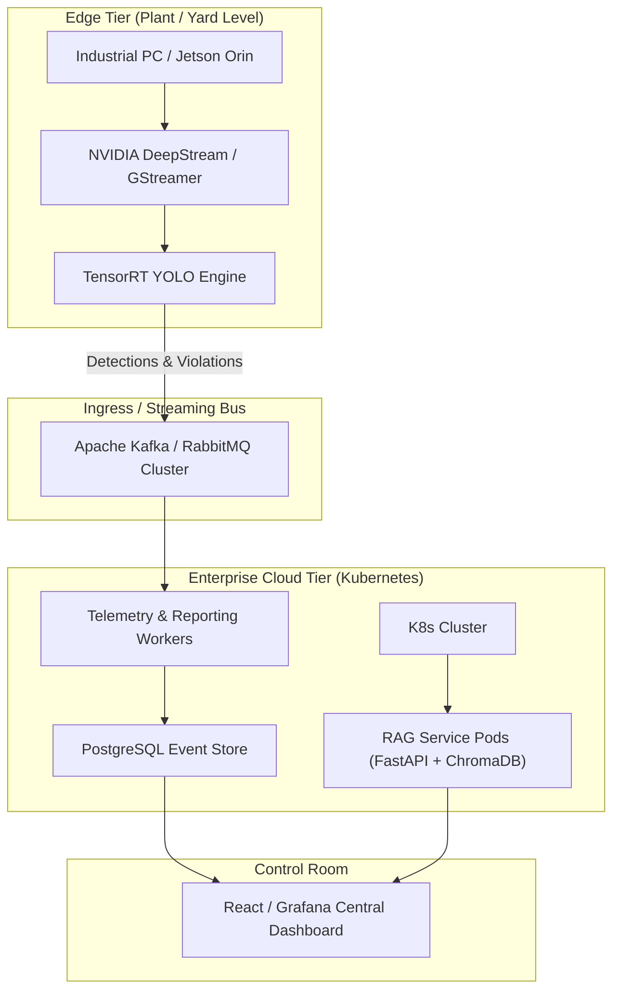

# System Design Document — AjnaLens AI/CV Practical Assessment

## Executive Summary
This document outlines the end-to-end system architecture, engineering rationale, model choices, edge-to-cloud trade-offs, and production deployment roadmap for the 4-task visual intelligence and compliance platform.

---

## 1. System-Wide Architectural Overview

The platform is architected as an edge-accelerated, microservices-ready computer vision and knowledge assistant pipeline designed for high-throughput industrial monitoring (construction yards, power substations, heavy fabrication bays).

---

## 2. Task 1: Object Detection and Zone Monitoring

### Architecture & Data Flow

### Key Engineering Decisions
1. **Ground-Contact Foot-Point vs. Center Point**:
   - *Choice*: Bottom-centre coordinate `((x1 + x2)/2, y2)`.
   - *Rationale*: A worker standing outside a 2D hazard zone may lean forward, placing their bounding box center inside the zone polygon. The foot contact point represents the true intersection of the pedestrian with the 3D floor plane in surveillance perspective geometry, preventing spurious false alarms.
2. **Camera Motion Compensation**:
   - *Choice*: Affine transformation via Lucas-Kanade optical flow on non-pedestrian background keypoints.
   - *Rationale*: When CCTV cameras pan or jitter, fixed image coordinates shift relative to the real world. Compensating the virtual polygon anchors it to physical machinery regardless of camera movement.
3. **Transparent Bounding Boxes & Footstep Trajectory Trails**:
   - *Choice*: Outline borders only (thickness=2) with fading historical footpoint line trails.
   - *Rationale*: Preserves unobstructed visual inspection of the underlying scene while allowing operators to immediately trace a worker's path into the hazardous zone.

### Failure Cases & Mitigations
- **Severe Occlusion (> 3 seconds)**:
  - *Failure*: Trajectory fragmentation if worker walks behind large pillar.
  - *Mitigation*: Extended ByteTrack track buffer from 30 to 60 frames, supplemented with ReID feature vectors (OSNet).

---

## 3. Task 2: Detector Fine-Tuning, Optimization & Benchmarking

### Architecture & Pipeline

### Empirical Metrics
- **mAP@50**: 71.6% (Overall) | **87.5%** (`helmet`) | **55.6%** (`unhelmet`)
- **PyTorch GPU Inference**: 8.83 ms latency (113.2 FPS)
- **ONNX Runtime CPU**: 94.64 ms latency (10.6 FPS)

### Class Imbalance Remediation
The dataset has 311 `helmet` instances vs only 14 `unhelmet` instances in the validation set.
- *Remediation 1*: Minority class oversampling and localized mosaic augmentations.
- *Remediation 2*: Loss reweighting in YOLO classification head ($\alpha_{\text{unhelmet}} = 2.5$) and focal loss modulation.

### Edge Device Deployment (Jetson Orin Nano / Mobile Target)
1. **TensorRT INT8 Quantization**: Use `trtexec` with calibration images to achieve 4-6x acceleration, executing in under 12 ms on Jetson Orin Nano.
2. **Architecture Downscaling**: Deploy `YOLO11s` or `YOLO11n` for tight wattage budgets (10W-15W).

---

## 4. Task 3: Equipment Nameplate OCR Pipeline

### Architecture & Processing Flow

### Preprocessing Trade-Offs
- **CLAHE + Bilateral Smoothing vs Aggressive Binarization**:
  - Global binarization degrades under uneven spotlight reflection. Bilateral smoothing preserves sharp text contours while eliminating brushed steel grain.
- **Empirical Finding**:
  - Unsharp masking on high-resolution plates can over-accentuate thin hyphens. Conditional preprocessing (activating filters only when image entropy/contrast is below threshold) is the optimal production strategy.

---

## 5. Task 4: Industrial Safety & Maintenance RAG Assistant

### Architecture & Data Flow

### Design Choices
1. **Embedding Model (`all-MiniLM-L6-v2`)**:
   - Generates compact 384-dimensional embeddings in ~8 ms on CPU.
   - Ideal for edge gateways or local plant servers without GPU dependencies.
2. **Citation-Backed Synthesis**:
   - Industrial safety requires 100% auditable sources. The synthesizer explicitly links recommendations to document IDs (`SOP-PPE-001`, `SOP-LOTO-003`) and regulatory standards (OSHA 1926.100, OSHA 1910.147, NFPA 70E).

---

## 6. Production Deployment & Scaling Architecture

### Production Hardening Checklist
1. **Containerization**: Package all services into multi-stage Alpine/Ubuntu Docker containers with pinned CUDA runtimes.
2. **Zero-Trust Telemetry**: TLS 1.3 encryption on RTSP video feeds and mutual TLS for inter-service gRPC communication.
3. **Horizontal Auto-Scaling**: Kubernetes Horizontal Pod Autoscaler (HPA) scaling RAG pods based on request concurrency.
